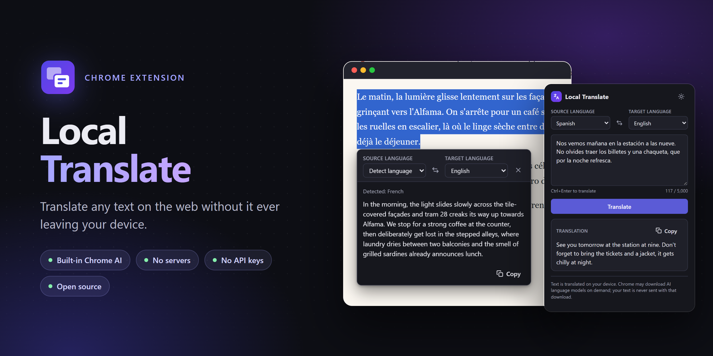
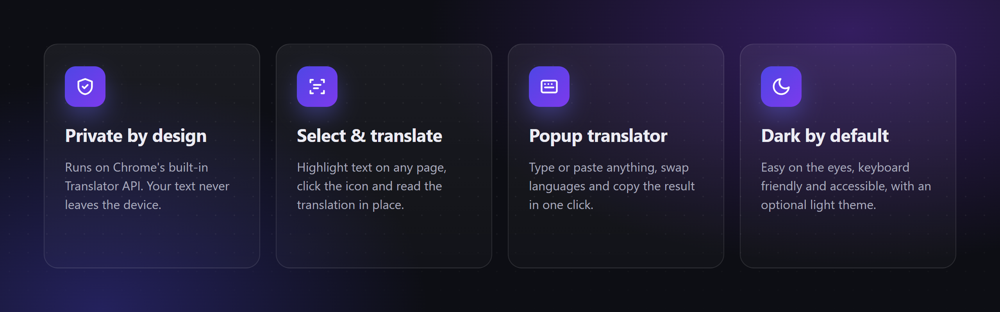
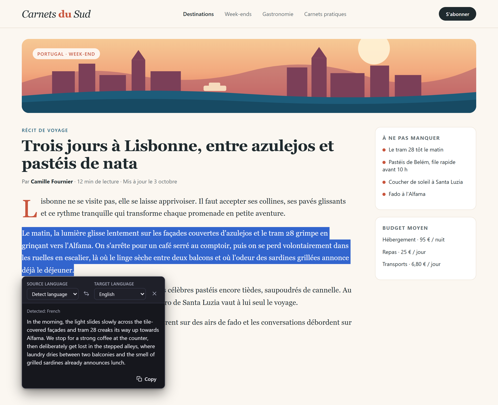
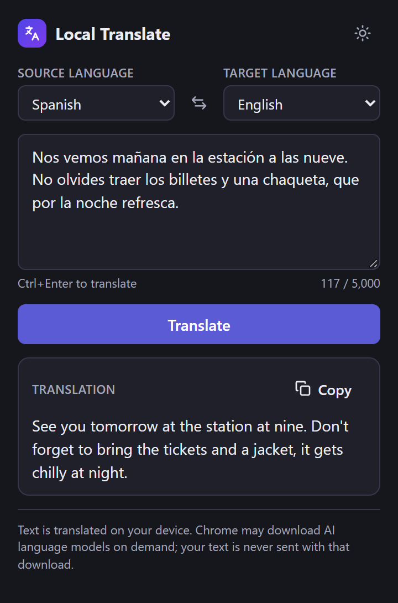
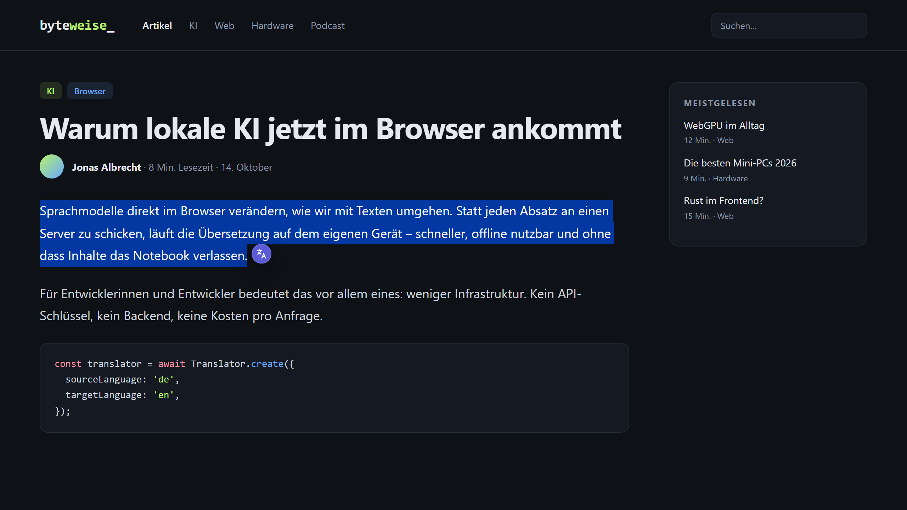
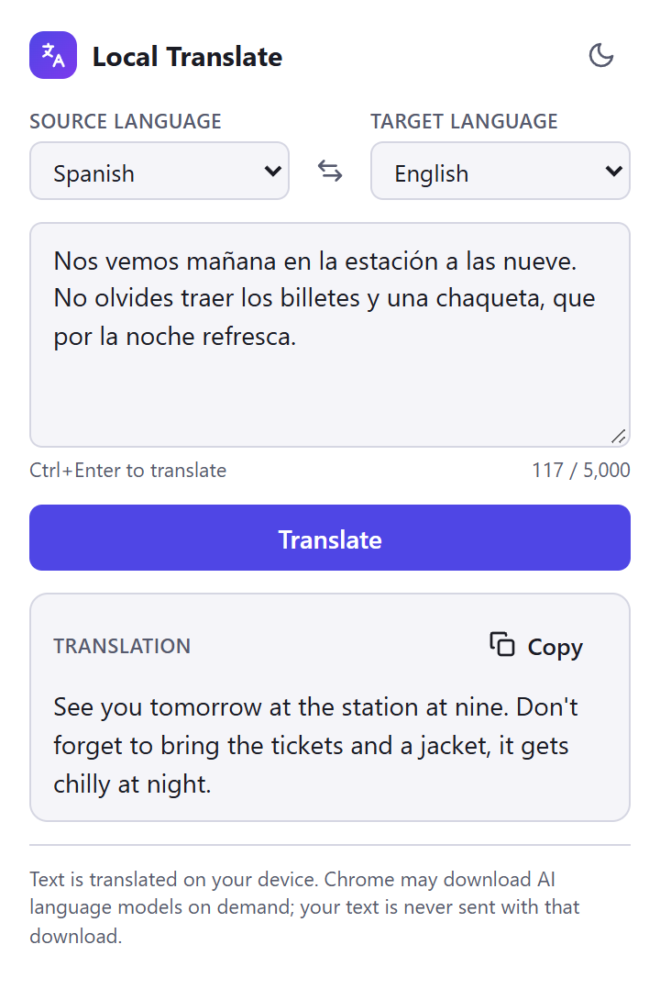

<p align="center">
  
</p>

<p align="center">
  <a href="LICENSE"></a>
  
  
  
</p>

**Local Translate** is a lightweight Chrome extension that translates selected text on any web page and text you type in its popup. It uses Chrome's [built-in Translator API](https://developer.chrome.com/docs/ai/translator-api), so translation runs **on your device**: no backend, no accounts, no API keys, and your text is never sent anywhere.

<p align="center">
  
</p>

## Features

- **Contextual translation.** Select text on a page and a small icon appears next to it. Click it to open a floating window with the translation, without leaving the page. Keyboard users can press `Alt+Shift+T` (configurable at `chrome://extensions/shortcuts`).
- **Manual translator.** Click the extension icon to type or paste text, pick languages, swap them (the swap also translates the result back) and copy the result. `Ctrl+Enter` translates.
- **Automatic language detection** through Chrome's built-in Language Detector API, or pick the source language yourself.
- **Real language support.** The language list is built at runtime by asking the engine; only languages Chrome reports as available or downloadable are offered.
- **Clear states.** Unsupported browser, unavailable language pair, model download with progress, offline, and translation errors are all explained in plain language.
- **Dark theme by default**, with an optional light theme.
- **Accessible.** Keyboard navigation, visible focus, labelled controls and live status announcements.
- **Doesn't get in the way.** The in-page UI lives in a closed Shadow DOM: it never modifies or replaces page content, and site styles cannot break it.
- UI available in **English and Spanish**, following the browser language.

## Screenshots

<table>
  <tr>
    <td width="62%"></td>
    <td width="38%"></td>
  </tr>
  <tr>
    <td></td>
    <td></td>
  </tr>
</table>

<sub>The websites shown are fictional demo pages included in <a href="docs/demo">docs/demo</a>.</sub>

## Requirements

- Desktop Chrome 138 or later with the built-in Translator API available.
- The first translation of a language pair may require Chrome to download the language model (internet connection and some disk space needed). Progress is shown while it downloads.

## Install

No tools or accounts needed.

1. **[Download `local-translate.zip`](https://github.com/SrPio/local-translate/releases/latest/download/local-translate.zip)** from the latest release and unzip it.
2. Open `chrome://extensions` in Chrome.
3. Turn on **Developer mode** (top-right corner).
4. Click **Load unpacked** and select the unzipped `local-translate` folder.
5. Optional: pin the extension from the puzzle-piece menu so its icon is always visible.

To update, download the new release, replace the folder and click the reload icon on the extension card in `chrome://extensions`.

## Build from source

For development you need Node.js 20+ and [pnpm](https://pnpm.io).

```bash
pnpm install
```

```bash
pnpm build
```

Then open `chrome://extensions`, enable **Developer mode**, click **Load unpacked** and select the `dist/` folder. The extension does not depend on any running server.

For development with hot reload, run `pnpm dev` and load `dist/` the same way.

| Command | Description |
| --- | --- |
| `pnpm dev` | Development build with hot reload |
| `pnpm build` | Type-check and build the extension into `dist/` |
| `pnpm test` | Unit and component tests (Vitest) |
| `pnpm lint` | ESLint |
| `pnpm typecheck` | TypeScript |
| `pnpm screenshots` | Regenerate the README images with headless Chrome (run `pnpm build` first; set `CHROME_PATH` if needed) |

## How it works

```
src/
  background/            service worker: lets the content script use session storage, relays the keyboard shortcut
  content/               selection detection, positioning, icon and closed Shadow DOM mounting
  components/            shared controls and the floating window
  popup/                 manual translator
  hooks/                 React state shared by both UIs (useTranslation, useLanguages, ...)
  services/translation/  shared translation service, end-to-end flow and error mapping
  services/languages/    available languages, detection and localized names
  shared/                constants, i18n, preferences, clipboard, theme tokens
tests/                   unit and component tests against a mocked Translator API
docs/demo/               fictional demo sites and banners used for the README images
```

- `TranslationService` is the only module that talks to the Translator API, and both the popup and the floating window use it. It reuses one translator per language pair (up to three, destroyed when evicted or when the page or popup closes).
- `runTranslation` implements the flow: validation → optional language detection → availability check → model download with progress → translation. A new request aborts the previous one, so stale results are never shown.
- There is **no silent fallback** to any external translation service.

## Permissions

| Permission | Why |
| --- | --- |
| `storage` | Remember the language pair for the browser session (`storage.session`) and the theme (`storage.local`). Text is never stored. |
| Content script on `http://*/*` and `https://*/*` | Detect selections and show the icon without any prior action. No additional `host_permissions` are requested. |

Chrome does not allow content scripts on internal pages (`chrome://`), the Chrome Web Store or the built-in PDF viewer; use the popup there.

## Privacy

- Text is processed by Chrome's on-device models only.
- No analytics, trackers, ads or remote code.
- No translation history is kept, and user text is never logged.

Read the full [privacy policy](PRIVACY.md).

## Known limitations

- If Chrome does not expose the Translator API to a page's content script, the floating window says so and suggests using the popup.
- Selections inside form fields and editors (`input`, `textarea`, `contenteditable`) are ignored.
- Chrome mobile, Firefox and Safari are not supported.

## Contributing

Issues and pull requests are welcome. Please run `pnpm lint`, `pnpm typecheck` and `pnpm test` before opening a pull request.

## License

[MIT](LICENSE) — free to use, modify and distribute.
